# Логическая модель данных

Схема в Mermaid; PNG — `diagrams/logical-data-model.png`.

```mermaid
erDiagram
    CLIENT["Клиент"] {
        string client_id PK "глобальный ID (MDM)"
        string fu_client_id "ID в FU CRM"
        string rb_client_id "ID в RB CRM"
        string party_type "физлицо / юрлицо"
        string segment_id FK "текущий сегмент"
        string branch_id FK "отделение обслуживания"
    }
    PERSON["Физлицо"] {
        string client_id PK "= ID клиента"
        string full_name
        date birth_date
        string passport
        string inn
        boolean is_entrepreneur "ИП"
        string ogrnip "для ИП"
    }
    ORGANIZATION["Юрлицо"] {
        string client_id PK "= ID клиента"
        string name
        string inn
        string ogrn
        string kpp
    }
    CONSENT["Согласие на обработку ПДн"] {
        string consent_id PK
        string client_id FK
        string purpose "цель обработки"
        string status
    }
    SEGMENT["Сегмент клиента"] {
        string segment_id PK
        string client_type
    }
    BRANCH["Отделение"] {
        string branch_id PK
        string region
    }
    PRODUCT["Продукт"] {
        string product_id PK
        string product_line
    }
    TARIFF["Тариф"] {
        string tariff_id PK
        string product_id FK
        string segment_id FK "необязательно"
    }
    CONTRACT["Договор"] {
        string contract_id PK
        string parent_contract_id FK "для заявлений к ДБО"
        string contract_type
        string product_id FK
        string tariff_id FK
        string branch_id FK "отделение заключения"
        string bank_party "FU / RB"
    }
    CONTRACT_PARTY["Участник договора"] {
        string contract_id FK
        string client_id FK
        string role "основной / созаёмщик / поручитель / доверенное лицо"
    }
    ACCOUNT["Счёт"] {
        string account_id PK
        string account_number
        string contract_id FK "обязательно"
        string branch_id FK "отделение открытия"
        string currency
    }
    CARD["Карта"] {
        string card_id PK
        string contract_id FK
        string card_type "дебетовая / кредитная"
        string holder_client_id FK
    }
    CARD_ACCOUNT["Счёт карты"] {
        string card_id FK
        string account_id FK
        string currency
        int priority "приоритет списания"
    }
    LOAN["Кредит"] {
        string loan_id PK
        string contract_id FK
        decimal amount
        string status
    }
    LOAN_ACCOUNT["Счёт кредита"] {
        string loan_id FK
        string account_id FK
        string purpose "основной долг / проценты / просрочка"
    }
    PAYMENT["Платёж"] {
        string payment_id PK
        string payer_account_id FK
        string initiator "клиент / взыскатель / банк"
        string loan_id FK "необязательно"
        decimal amount
    }
    TRANSACTION["Транзакция"] {
        string transaction_id PK
        string account_id FK
        string payment_id FK "необязательно"
        string card_id FK "необязательно"
        string direction "дебет / кредит"
        decimal amount
    }
    APPEAL["Обращение"] {
        string appeal_id PK
        string client_id FK
        string product_id FK "необязательно"
        string contract_id FK "необязательно"
        string account_id FK "необязательно"
        string card_id FK "необязательно"
        string transaction_id FK "необязательно"
    }

    CLIENT ||--o| PERSON : "подкласс"
    CLIENT ||--o| ORGANIZATION : "подкласс"
    CLIENT ||--o{ CONSENT : "даёт"
    CLIENT }o--|| SEGMENT : "относится к"
    CLIENT }o--o| BRANCH : "обслуживается в"
    CLIENT ||--o{ CONTRACT_PARTY : "участвует"
    CONTRACT ||--|{ CONTRACT_PARTY : "имеет участников"
    CONTRACT }o--|| PRODUCT : "по продукту"
    CONTRACT }o--|| TARIFF : "по тарифу"
    CONTRACT }o--o| BRANCH : "заключён в"
    CONTRACT |o--o{ CONTRACT : "заявление к ДБО"
    PRODUCT ||--o{ TARIFF : "имеет"
    TARIFF }o--o| SEGMENT : "для сегмента"
    CONTRACT ||--o{ ACCOUNT : "основание счёта"
    ACCOUNT }o--o| BRANCH : "открыт в"
    CONTRACT ||--o{ CARD : "основание карты"
    CLIENT ||--o{ CARD : "держатель"
    CARD ||--|{ CARD_ACCOUNT : "привязана к"
    ACCOUNT ||--o{ CARD_ACCOUNT : "доступен по"
    CONTRACT ||--o| LOAN : "кредитный договор"
    LOAN ||--|{ LOAN_ACCOUNT : "учитывается на"
    ACCOUNT ||--o| LOAN_ACCOUNT : "счёт кредита"
    ACCOUNT ||--o{ TRANSACTION : "операции"
    ACCOUNT ||--o{ PAYMENT : "плательщик"
    PAYMENT |o--o{ TRANSACTION : "исполнен"
    CARD |o--o{ TRANSACTION : "карточные операции"
    LOAN |o--o{ PAYMENT : "погашения"
    CLIENT ||--o{ APPEAL : "обращается"
    APPEAL }o--o| PRODUCT : "о продукте"
    APPEAL }o--o| CONTRACT : "о договоре"
    APPEAL }o--o| ACCOUNT : "о счёте"
    APPEAL }o--o| CARD : "о карте"
    APPEAL }o--o| TRANSACTION : "об операции"
```

## Решения по связям

| Связь | Решение | Обоснование | Цена |
|---|---|---|---|
| Клиент — Физлицо / Юрлицо | Общий объект с двумя подклассами, у каждого клиента ровно один подкласс; ИП — подкласс физлица | Договор, счёт и MDM работают с клиентом независимо от типа; у физлиц и юрлиц разные идентификаторы, правила сопоставления и защита данных; один человек — одна запись | Полный профиль собирается двумя соединениями; правило «ровно один подкласс» — проверка качества данных |
| Договор — Клиент | Многие ко многим через «Участник договора» с ролью | При склейке дублей в MDM клиент упоминается в одном месте | Правило «ровно один основной участник» — проверка качества данных, а не ограничение БД |
| Счёт — Клиент | Через договор (участники договора), ссылка счёта на договор обязательна | Счёт открывается на основании договора банковского счёта, права на счёт определяются договором | «Чей счёт» — два перехода; допустим кэш владельца, обновляемый по событию изменения участников |
| Карта — Счёт | Многие ко многим через «Счёт карты» с валютой и приоритетом списания | Модель не запрещает мультивалютную карту | Одна связующая сущность |
| Кредит — Счёт | Один ко многим через «Счёт кредита» с назначением счёта | По кредиту ведётся несколько счетов с разным назначением | Одна связующая сущность |
| Транзакция — Счёт | Транзакция — операция по одному счёту клиента | Межбанковский перевод не имеет второго счёта внутри банка, контрагент — в реквизитах платежа | Проводки Дт/Кт остаются в Core |
| Платёж — Транзакция | Две сущности, связь необязательная | Платёж — распоряжение о переводе, транзакция — факт движения средств; проценты, комиссии и карточные операции идут без платёжного документа | — |
| Клиент — Сегмент | Только текущий сегмент | История ведётся в DWH | Изменения сегмента должны попадать в DWH по событию |
| Продукт — Тариф | Один ко многим | Условия каждого продукта меняются независимо | Дублирование одинаковых условий у разных продуктов |
| Обращение — предмет | Отдельная необязательная ссылка на каждый тип объекта | Связи явные и проверяются БД | Пустые поля; новый тип объекта меняет структуру |
