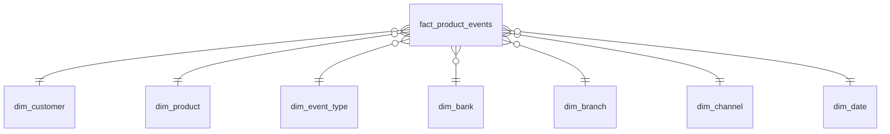

# Аналитическая модель: клиенты и продукты

Схема «звезда». Аналитическая область — открытие и закрытие продуктов клиентами обоих банков. Одна строка факта — одно событие открытия или закрытия одного договора. Клиент в строке — основной участник договора, поэтому каждый договор попадает в факт один раз.

| Тип таблицы | Таблица | Содержание |
|---|---|---|
| Fact | fact_product_events | Событие открытия или закрытия договора: ключи измерений; ID договора в системе-источнике и код системы-источника — ключ дедупликации при повторной загрузке; количество событий; сумма договора (кредиты, вклады) и кредитный лимит (карты) — отдельные колонки, пустые для продуктов, где не применимы |
| Dimension | dim_customer | Клиент по глобальному ID из MDM: тип клиента, сегмент, регион; история изменений сегмента хранится версиями записи |
| Dimension | dim_product | Продукт: продуктовая линия, банк-владелец, соответствующий продукт FinUnion |
| Dimension | dim_event_type | Тип события: открытие, закрытие |
| Dimension | dim_bank | Банк — сторона договора: FinUnion, RetailBank |
| Dimension | dim_branch | Отделение и регион |
| Dimension | dim_channel | Канал: офис, мобильное приложение, веб |
| Dimension | dim_date | Календарная дата события |

Почему модель подходит для OLAP-нагрузки:

- Модель понятна BI-пользователям: каждое измерение соединяется с фактом напрямую, без цепочек справочников. Снежинка не нужна: иерархия продуктов неглубокая, а соответствие продукта RetailBank продукту FinUnion — один атрибут dim_product.
- Аналитические запросы — агрегаты по измерениям: сколько клиентов RetailBank открыли продукты FinUnion за месяц, в каком сегменте и регионе. В звезде это одно соединение факта с нужными измерениями.
- Клиент в измерении один — по глобальному ID из MDM, поэтому клиент обоих банков не считается дважды.
- Сегмент хранится версиями записи клиента: отчёт за прошлый период показывает сегмент, действовавший тогда.
- Строк факта немного: одна на событие, а не на каждый день владения продуктом.

Ограничения:

- Вопрос «сколько продуктов у клиента сейчас» требует суммирования всех событий; при необходимости над фактом строится витрина текущего портфеля клиента.
- Созаёмщики, поручители и доверенные лица в этой области не видны: в факте только основной участник договора.
