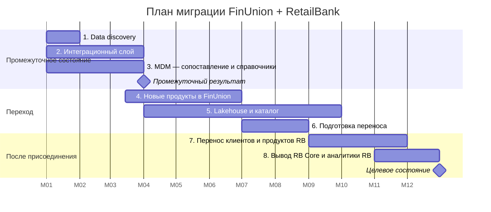

# Инкрементальный план миграции

Допущение по срокам: присоединение RetailBank завершается не позднее 9-го месяца. Перенос договоров, счетов, карт и кредитов RetailBank в системы FinUnion возможен только после присоединения, когда FinUnion становится правопреемником по договорам.

| Этап | Сроки | Содержание | Результат |
|---|---|---|---|
| 1. Data discovery | Месяц 1 | Инвентаризация систем, таблиц, потоков и владельцев обоих банков; профилирование данных: доля пустых значений, фактические форматы, уникальность ключей; проверка доступности CDC для каждой системы RetailBank; сопоставление моделей данных с логической моделью и BIAN | Реестр данных, назначенные владельцы и стюарды |
| 2. Интеграционный слой | Месяцы 1–3 | Kafka и CDC для систем RetailBank и FinUnion; загрузка исходных данных обоих банков в DWH FinUnion | Данные обоих банков в DWH без нагрузки на операционные системы |
| 3. MDM: сопоставление и справочники | Месяцы 1–3 | Правила сопоставления клиентов, единый идентификатор; справочники продуктов, тарифов, отделений, сегментов в MDM, маппинг кодов RetailBank | Промежуточное состояние: единый ID, матрица мастер-систем, минимальный набор витрин BI, единая управленческая отчётность |
| 4. Новые продукты в FinUnion | Месяцы 3–6 | Как только у клиентов RetailBank есть глобальный ID (результат этапа 3), их новые счета и продукты открываются в системах FinUnion; к 6-му месяцу золотая запись MDM становится эталоном для FU CRM | Новые обязательства возникают только в системах FinUnion |
| 5. Lakehouse и каталог | Месяцы 4–9 | Развитие Data Lake FinUnion в Lakehouse; загрузка истории операций обоих банков; каталог и lineage в DataHub | История в Lakehouse, трассируемость данных |
| 6. Подготовка переноса | Месяцы 7–8 | Сопоставление продуктов и тарифов RetailBank с продуктами FinUnion; состав волн по группам клиентов (по отделениям RetailBank); тестовые прогоны cutover на обезличенных копиях данных; обучение операторов RetailBank работе в FU CRM | План волн, отработанная процедура cutover |
| 7. Перенос клиентов и продуктов RetailBank | Месяцы 9–11, после присоединения | Волнами по группам клиентов. Первая волна — пилотная группа отделений, не упрощённая: в ней есть кредиты с просрочкой, валютные счета и ИП. Клиент переходит в FU CRM и на мастер MDM вместе со всеми своими договорами, счетами, картами и кредитами; после последней волны вывод RB CRM, RB Cards и RB Loans | Клиенты и действующие продукты RetailBank обслуживаются в системах FinUnion, MDM — единственный мастер клиента |
| 8. Вывод RB Core и аналитики RetailBank | Месяцы 11–12 | Финальный перенос остатков, вывод RB Core, RB DWH, RB BI; архив данных RetailBank; единая регуляторная отчётность | Целевое состояние, системы RetailBank отключены |

Сроки — ориентир. Этап завершается, когда достигнут его результат и владелец данных подтвердил его, а не по календарной дате.

## Дорожная карта этапов

Даты условные: месяц 1 — январь.

## Временные компоненты

| Компонент | Когда выводится | Ответственный |
|---|---|---|
| CDC-потоки из систем RetailBank | Вместе с выводом каждой системы RetailBank | Команда интеграции |
| Поток RB CRM → MDM | После последней волны этапа 7 | Data Office |
| Таблица соответствия идентификаторов RetailBank и глобальных ID | Переводится в архив RetailBank после этапа 8: нужна для поиска по архиву | Data Office |
| RB DWH и регуляторная отчётность RetailBank | Этап 8, после первой единой регуляторной отчётности из DWH FinUnion | Финансовый департамент |
| Сверочная витрина «правила FU / правила RB» | Вместе с RB DWH | Финансовый департамент |
| Зачисление платежей по старым реквизитам RetailBank | По окончании согласованного переходного периода после этапа 8 | Финансовый департамент |
